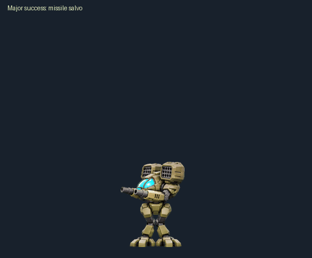

# Mini Mad Cat

A tiny Mad Cat / Timber Wolf desktop copilot: it watches the pointer, follows it on request, salutes victories, fires lasers and missiles, and gets knocked down and back up when a task fails.



## Download and start

Download the complete ZIP from [Releases](https://github.com/jtalweezy/mini-mad-cat/releases/latest), then extract it to a permanent folder. Install Node.js 22 or newer. In the extracted folder:

```sh
npm ci
npm test
npm run check:art
npm start
```

Windows also includes `install.ps1`; macOS/Linux include `install.sh`. In Windows PowerShell, use `npm.cmd` if your execution policy blocks `npm.ps1`. Dependencies are locked; installation downloads the Electron runtime for the target operating system. The download is a source kit, not a signed OS installer.

**On a Mac:** follow the [macOS installation guide](docs/MACOS.md) for Apple silicon/Intel requirements, `sh ./install.sh`, standalone controls, and optional connections to the same local agents. No Docker or MCP client is needed to run the pet.

The default is a stationary mech that looks toward the mouse pointer. Drag the visible mech to move it, double-click to salute, or use the tray/right-click menu. Enable **Follow cursor** to make it chase. Transparent space passes pointer clicks through. The menu includes reduced motion, context bubbles, scale, reset, and quit. `Ctrl+Alt+M` / `Cmd+Alt+M` shows or hides it.

For tracking only after you interact with it, open the tray or right-click menu and choose **Mouse tracking → 15 seconds after click**. Each primary click on the visible mech, or the end of a drag, starts a fresh 15-second window for looking toward the pointer and optional **Follow cursor** movement. It returns to its normal idle animation when the window ends. **Always** keeps the original behavior; **Off** disables automatic looking and chasing. Turn **Click through** off in the tray before trying to activate it by clicking. The chosen mode is saved, while the temporary tracking window resets when the app restarts.

## Connect your chat agent

The companion runs beside desktop applications. Its MCP bridge lets a local agent report task activity and outcomes. Codex, Claude Desktop, Claude Code, Cursor IDE, and Grok Build setup is documented in [INTEGRATIONS.md](INTEGRATIONS.md). Native wrapper preparation and lifecycle hooks are covered in [NATIVE_PLUGIN.md](NATIVE_PLUGIN.md). Give another agent [AGENT_HANDOFF.md](AGENT_HANDOFF.md) to install the bundle.

To print an MCP configuration with the actual absolute paths on your computer:

```sh
npm run config
```

The server command is your Node executable; its argument is the absolute path to `bridge/mcp.cjs`. Start the desktop companion separately with `npm start`. For example, Codex CLI registration is:

```sh
codex mcp add mini-mad-cat -- node /ABS/BUNDLE/bridge/mcp.cjs
```

The agent tools include `pet_status`, `pet_animate`, `pet_configure`, `pet_reset`, and `pet_react`. Use `running` for active work, `waiting` for required input, and `review` while checking results. Report actual task results with `pet_react`; a completed assistant turn alone does not establish task success.

```json
{
  "outcome": "success",
  "impact": 1,
  "confidence": 0.98,
  "severity": 0,
  "message": "ENEMY DESTROYED"
}
```

An agent with shell access can send the same event through stdin:

```sh
node bridge/event.cjs < examples/success.json
```

In PowerShell:

```powershell
Get-Content examples/success.json -Raw | node bridge/event.cjs
```

## Reactions and modifiers

| Event | Default reaction |
| --- | --- |
| High-weight success | Missile salvo and **ENEMY DESTROYED** |
| Medium-weight success | Cyan laser and **OBJECTIVE SECURED** |
| Small success | Salute and **OBJECTIVE SECURED** |
| Failure | One knockdown/recovery cycle; heavier failures add an impact burst and longer recovery |
| Partial result | Inspection pose and **RECALIBRATING** |
| Blocked task | Waiting pose and **HOLDING FOR ORDERS** |

Edit [config/reactions.json](config/reactions.json) to change weights, effect thresholds, cooldown, and default messages; restart the companion after editing. Scores are weighted averages from explicit agent-supplied numbers in the range 0–1. The defaults use `0.6 × impact + 0.4 × confidence` for success, with laser at 0.55 and missiles at 0.8. Failure uses severity 0.55, impact 0.30, and confidence 0.15. This is a configurable presentation policy, not a claim that the companion independently judges a chat's correctness.

The default cooldown is 2.5 seconds. Context bubbles can be disabled, and reduced motion suppresses weapon effects and animated reactions. Bubbles are rendered as plain text, capped at 96 characters. No chat transcript, prompt, screenshot, or API credential is required by the companion.

## Platforms and boundaries

Windows, macOS, and Linux are desktop targets. Native Wayland restricts the global cursor/window positioning needed for following; use X11 or compatible XWayland (`npm start -- --ozone-platform=x11`). Check [VALIDATION.md](VALIDATION.md) for what was actually tested.

Grok Bot's cloud desktop and the hosted xAI API cannot directly reach a user's local stdio process. The integration guide describes the supported local Grok Build route and the additional authenticated bridge needed for hosted environments. The overlay can remain visible alongside any local application even without an agent connection.

The sprite sheet also uses the ChatGPT Pets v2 format: 1536×2288, 192×208 cells, nine standard animations and sixteen look directions. Native ChatGPT Pets uses that artwork. Weapon effects, weighted event handling, and text bubbles run in this separate desktop companion.

## Local control and privacy

The app binds an authenticated control server to `127.0.0.1` on a random port. Its same-user bridge discovers a random token in the per-user application data directory. Browser-origin requests are rejected. The renderer has Node disabled, context isolation, sandboxing, and a restrictive content policy. There is no analytics or automatic public endpoint.

`MADCAT_HOME` can choose a separate local settings directory. The final directory must be a real directory, not a symlink or junction. On macOS/Linux it must belong to the current user and allow no group or other access (normally mode `0700`); token files are published atomically with mode `0600`. Parent directory aliases remain supported. On Windows, file modes do not enforce ACL privacy: a custom directory must inherit private ACLs accessible only to your account and trusted system administrators. Use a private location with trusted parent directories, never a shared folder. Do not distribute that directory: it holds a runtime token. The installer does not register global agents or startup services. Uninstall by removing this server's configuration entry, closing the app, and deleting the extracted bundle.

## Development

```sh
npm test
npm run check:art
npm run test:gui
```

The tests cover direction geometry, frame selection, reaction weighting and one-shot recovery, MCP protocol discovery, command validation, and loopback authentication. GUI smoke tests render the real artwork and exercise the local bridge. Each invocation keeps captures in a new private `runtime-smoke/mini-mad-cat-smoke-*` run folder and removes only that run's temporary app data. To choose a different existing output parent, use `npm run test:gui -- /path/to/output`; the test creates a fresh child there and never reuses an existing case folder. Use a private destination with trusted parent directories. Creation source strips and prompts are included in the separate artwork source archive in Releases.

This is a fan-made MechWarrior/BattleTech-inspired companion. Code is MIT licensed. Artwork is provided for personal desktop-companion use; character and trademark rights remain with their respective owners. The project is not an official BattleTech or MechWarrior product.
